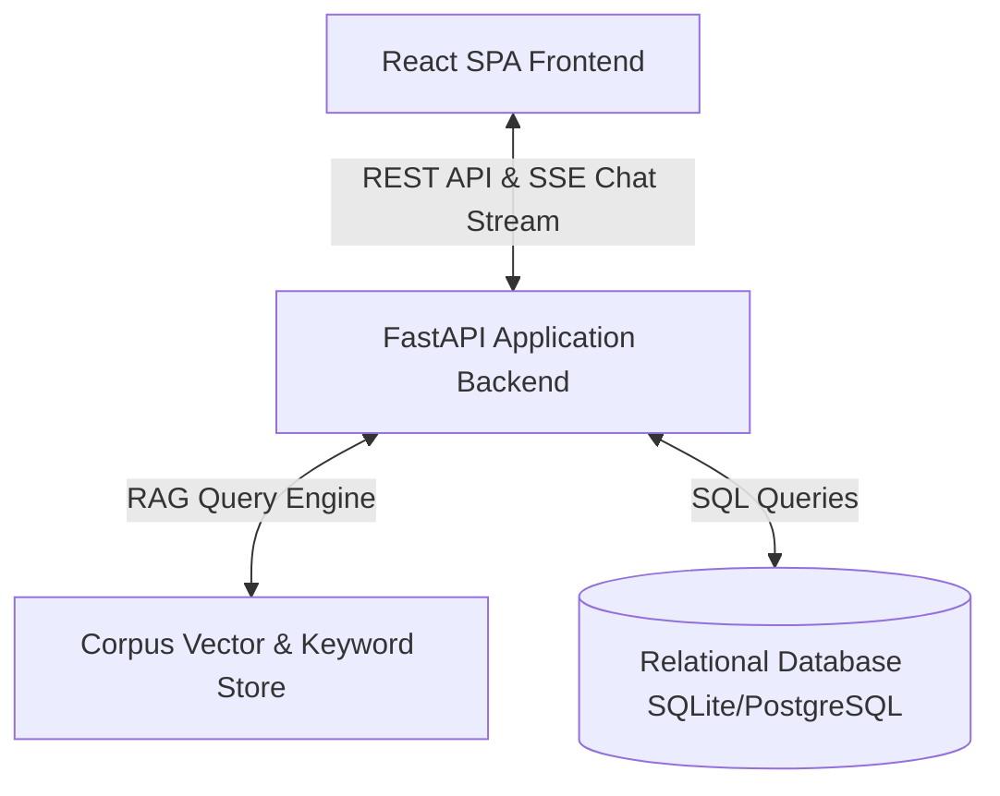

# Technical Implementation Plan (plan.md)

**Project**: Purdue University Northwest Knowledge Chatbot  
**Tech Stack**: FastAPI + React + SQLite/PostgreSQL  

---

## 1. Architecture Summary
The system is built as a single deployable Layered Monolith containing a FastAPI application backend and a React SPA frontend.

---

## 2. Component Design & Directory Layout

- `db/`: SQL schema DDL (`schema.sql`), benchmark queries (`sample_queries.sql`), and seed data script (`seed_data.py`).
- `backend/models/`: Pydantic validation schemas (`schemas.py`) for API request/response validation.
- `backend/services/`:
  - `rag_service.py`: Chunk indexing, similarity calculation, grounded answer synthesis, citation matching, and fail-safe threshold enforcement.
  - `prereq_service.py`: Course prerequisite graph construction and campus tag resolution.
  - `schedule_service.py`: Academic schedule deadline lookup and current date validation.
- `backend/routers/`:
  - `chat.py`: SSE streaming chat endpoint `POST /api/chat/stream`.
  - `schedule.py`: Schedule table API `GET /api/schedule`.
  - `prereq.py`: Course prerequisite API `GET /api/prerequisites`.
  - `campus.py`: Campus management API `POST /api/campus`.
- `frontend/`:
  - `src/components/CampusSelector.jsx`: Modal for Hammond vs. Westville campus selection.
  - `src/components/ChatWindow.jsx`: Interactive streaming chat interface with citation links and fail-safe alerts.
  - `src/components/ScheduleTable.jsx`: Filterable academic schedule deadline table.
  - `src/components/PrereqGraph.jsx`: Interactive prerequisite tree visualizer.

---

## 3. Constitution Check
- ✅ **Grounded Answers**: RAG service verifies match threshold before returning citations.
- ✅ **Fail-Safe Guardrail**: Low match scores trigger explicit "I don't know" safe refusal.
- ✅ **Multi-Campus Context**: Campus ID passed down to query filters.
- ✅ **Table & Prereq Integrity**: Structured SQL representation preserves exact schedule dates and prerequisite links.
