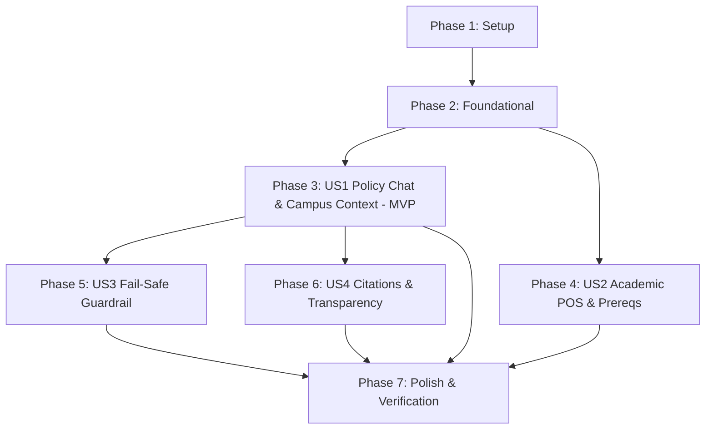

# Tasks: Purdue Northwest (PNW) Knowledge Chatbot

**Input**: Design documents from `docs/` (`spec.md`, `plan.md`, `research.md`, `data-model.md`, `contracts/openapi.json`, `quickstart.md`)  
**Prerequisites**: `plan.md` (required), `spec.md` (required for user stories), `research.md`, `data-model.md`, `contracts/`  
**Constitution**: Enforces Grounded Answers, Fail-Safe Guardrail ($S < 0.45$), Multi-Campus Awareness, and Citation Transparency.

## Format: `- [ ] [ID] [P?] [Story?] Description with file path`

- **[P]**: Can run in parallel (different files, no shared dependencies)
- **[Story]**: Which user story this task belongs to (`[US1]`, `[US2]`, `[US3]`, `[US4]`)
- Include exact file paths and quoted validation constraints in descriptions

---

## Phase 1: Setup (Shared Infrastructure)

**Purpose**: Project initialization, environment setup, and dependency configuration

- [X] T001 Initialize repository structure and configuration in `requirements.txt`, `pyproject.toml`, `.gitignore`, and `README.md`
- [X] T002 [P] Configure Python 3.11+ virtual environment dependencies (FastAPI, Uvicorn, Pydantic, Pytest) in `pyproject.toml`
- [X] T003 [P] Configure pytest test runner harness in `tests/test_api.py` and `tests/test_rag.py`

---

## Phase 2: Foundational (Blocking Prerequisites)

**Purpose**: Core database schema, seed data, application server shell, and shared styling that MUST be complete before ANY user story can be implemented

**⚠️ CRITICAL**: No user story work can begin until this phase is complete

- [ ] T004 Define relational database schema with tables `campuses`, `documents`, `document_chunks`, `academic_schedules`, `course_prerequisites`, `parking_rules`, `user_conversations`, `chat_messages` including primary/foreign keys and constraint `CHECK (refund_percentage BETWEEN 0 AND 100)` in `db/schema.sql`
- [ ] T005 [P] Implement SQLite database connection management and transaction helpers in `backend/database.py`
- [ ] T006 [P] Implement corpus seeding script to ingest official PNW documentation (Student Handbook, Parking Rules, Academic Catalog) and campuses (`HAMMOND`, `WESTVILLE`) in `db/seed_data.py`
- [ ] T007 [P] Create benchmark SQL verification queries in `db/sample_queries.sql`
- [ ] T008 Initialize FastAPI application with CORS middleware, static asset mounting, and health check endpoint in `backend/main.py`
- [ ] T009 [P] Implement campus listing endpoint `GET /api/campus` returning active campuses in `backend/routers/campus.py`
- [ ] T010 [P] Build frontend base HTML layout with campus selector modal and navigation tabs in `frontend/index.html`
- [ ] T011 [P] Build PNW Gold and Dark visual design system stylesheet in `frontend/styles.css`

**Checkpoint**: Foundation ready — database seeded, FastAPI server initialized, base UI styled. User story implementation can now begin.

---

## Phase 3: User Story 1 - Direct Grounded Answers for University Policies & Campus Services (Priority: P1) 🎯 MVP

**Goal**: Deliver an interactive chatbot enabling registered PNW students to ask questions regarding campus policies, parking rules, office locations, and add/drop procedures with campus filtering (Hammond vs. Westville).

**Independent Test**: Query the chatbot with specific policy questions (e.g., "How do I pay parking citations at Hammond?"). The chatbot returns concise, accurate instructions grounded in official PNW documentation and distinguishes Hammond from Westville rules.

### Tests for User Story 1

- [ ] T012 [P] [US1] Unit test RAG chunk retrieval, TF-IDF term overlap scoring, and campus filtering in `tests/test_rag.py`
- [ ] T013 [P] [US1] Integration test for chat endpoints (`POST /api/chat`, `POST /api/chat/stream`) in `tests/test_api.py`

### Implementation for User Story 1

- [ ] T014 [P] [US1] Define Pydantic request/response schemas `ChatRequest` (validate non-empty `query` required, optional `campus_id`, optional `session_id`) and `ChatResponse` in `backend/models/schemas.py`
- [ ] T015 [US1] Implement RAG query engine with document chunk indexing, TF-IDF + Cosine similarity calculation, and `campus_id` filtering in `backend/services/rag_service.py`
- [ ] T016 [US1] Implement synchronous chat endpoint `POST /api/chat` with input validation in `backend/routers/chat.py`
- [ ] T017 [US1] Implement Server-Sent Events (SSE) streaming chat endpoint `POST /api/chat/stream` delivering tokens and metadata in `backend/routers/chat.py`
- [ ] T018 [US1] Implement React chat UI with message list, query input, SSE stream reader, and campus selector modal in `frontend/app.js`
- [ ] T019 [US1] Add campus switching controls and session persistence to the UI header in `frontend/app.js`

**Checkpoint**: At this point, User Story 1 is fully functional and testable independently as an MVP.

---

## Phase 4: User Story 2 - Academic Requirements & Plan of Study (POS) Guidance (Priority: P1)

**Goal**: Enable students to query degree requirements, plan of study (EPOS) workflows, term refund/drop deadlines, and course prerequisite trees.

**Independent Test**: Query "How do I submit my Computer Science MS Plan of Study?" or lookup prerequisites for `CS 30200`. The chatbot outlines the EPOS workflow with advisor clearance steps, and the Prerequisite tool returns the visual graph with required minimum grades and campus tags.

### Tests for User Story 2

- [ ] T020 [P] [US2] Integration test for academic schedule lookup (`GET /api/schedule`) in `tests/test_api.py`
- [ ] T021 [P] [US2] Integration test for course prerequisite dependency graph lookup (`GET /api/prerequisites`) in `tests/test_api.py`

### Implementation for User Story 2

- [ ] T022 [P] [US2] Define Pydantic schemas `ScheduleItem` and `PrereqResponse` with constraint `campus_availability IN ('HAMMOND_AND_WESTVILLE', 'HAMMOND_ONLY', 'WESTVILLE_ONLY')` in `backend/models/schemas.py`
- [ ] T023 [P] [US2] Implement academic schedule lookup service querying `academic_schedules` table without date scrambling in `backend/services/schedule_service.py`
- [ ] T024 [P] [US2] Implement course prerequisite graph resolution service querying `course_prerequisites` in `backend/services/prereq_service.py`
- [ ] T025 [US2] Implement REST endpoint `GET /api/schedule` with optional `term` query parameter in `backend/routers/schedule.py`
- [ ] T026 [US2] Implement REST endpoint `GET /api/prerequisites` with `course_code` parameter in `backend/routers/prereq.py`
- [ ] T027 [US2] Build filterable Academic Schedule deadline table view in `frontend/app.js` and `frontend/index.html`
- [ ] T028 [US2] Build interactive Course Prerequisite tree visualizer with search filter in `frontend/app.js` and `frontend/index.html`

**Checkpoint**: User Stories 1 AND 2 are both independently functional and accessible via UI navigation tabs.

---

## Phase 5: User Story 3 - Fail-Safe & Departmental Routing (Priority: P2)

**Goal**: Guarantee that when a student asks an out-of-scope, unsupported, or ambiguous question, the chatbot safely refuses to answer and routes the student to official department contacts (Dean of Students, Registrar, Financial Aid).

**Independent Test**: Submit a question not covered by the corpus (e.g., "What is the recipe for chocolate chip cookies?"). The system outputs a polite refusal ("I don't know") and displays contact information for the Dean of Students office.

### Tests for User Story 3

- [ ] T029 [P] [US3] Unit test fail-safe guardrail triggering when similarity score $S < 0.45$ in `tests/test_rag.py`
- [ ] T030 [P] [US3] Integration test verifying ungrounded query returns `is_grounded: false` and departmental routing info in `tests/test_api.py`

### Implementation for User Story 3

- [ ] T031 [US3] Implement fail-safe score thresholding ($S < 0.45 \implies \text{is\_grounded} = \text{False}$) and departmental contact directory mapping in `backend/services/rag_service.py`
- [ ] T032 [US3] Integrate fail-safe payload into SSE stream metadata and JSON response in `backend/routers/chat.py`
- [ ] T033 [US3] Build client-side warning alert card and departmental contact button rendering for ungrounded responses in `frontend/app.js` and `frontend/styles.css`

**Checkpoint**: System safely handles adversarial, out-of-scope, and ambiguous queries with 0% ungrounded hallucinations.

---

## Phase 6: User Story 4 - Citation & Source Transparency (Priority: P3)

**Goal**: Ensure students receive clickable official PNW documentation source URLs and section headings with every answer for full transparency and verification.

**Independent Test**: Ask any valid policy question. Verify that the response includes clickable markdown links and citation badges pointing to official university web pages or PDFs.

### Tests for User Story 4

- [ ] T034 [P] [US4] Integration test verifying `citations` array contains `title` and `source_url` for all grounded responses in `tests/test_api.py`

### Implementation for User Story 4

- [ ] T035 [P] [US4] Define `Citation` schema with `title`, `source_url`, and `section` in `backend/models/schemas.py`
- [ ] T036 [US4] Extract document metadata (`title`, `source_url`, `section_title`) from matched corpus chunks and attach to response in `backend/services/rag_service.py`
- [ ] T037 [US4] Render clickable citation pills and popover links below assistant message bubbles in `frontend/app.js` and `frontend/styles.css`

**Checkpoint**: All user stories (US1 through US4) are fully functional and integrated.

---

## Phase 7: Polish & Cross-Cutting Concerns

**Purpose**: Cross-cutting verification, documentation alignment, and end-to-end testing

- [ ] T038 [P] Align OpenAPI contract specifications with all router endpoints in `docs/contracts/openapi.json`
- [ ] T039 [P] Document local run and validation commands in `docs/quickstart.md`
- [ ] T040 Execute full automated test suite covering RAG, API endpoints, and fail-safe guardrails via `pytest tests/`
- [ ] T041 Perform manual validation checklist covering campus selection, streaming chat, schedule table, and prerequisite visualizer per `docs/quickstart.md`

---

## Dependencies & Execution Order

### Phase Dependencies

- **Setup (Phase 1)**: No dependencies — executes first
- **Foundational (Phase 2)**: Depends on Setup completion — **BLOCKS all user stories**
- **User Story 1 (Phase 3)**: Depends on Foundational completion — Delivers core MVP
- **User Story 2 (Phase 4)**: Depends on Foundational completion — Can proceed in parallel with US1
- **User Story 3 (Phase 5)**: Depends on US1 RAG service implementation
- **User Story 4 (Phase 6)**: Depends on US1 RAG service implementation
- **Polish (Phase 7)**: Depends on all user story phases being complete



---

## Parallel Opportunities

- **Phase 1**: `T002` (dependencies) and `T003` (pytest harness) can run in parallel
- **Phase 2**: `T005` (database), `T006` (seeds), `T007` (SQL queries), `T009` (campus router), `T010` (HTML), `T011` (CSS) can run in parallel
- **Phase 3 (US1)**: `T012` (unit tests) and `T013` (integration tests) can run in parallel
- **Phase 4 (US2)**: `T020` (schedule test), `T021` (prereq test), `T022` (schemas), `T023` (schedule service), `T024` (prereq service) can run in parallel
- **Phase 5 (US3)**: `T029` (guardrail test) and `T030` (integration test) can run in parallel
- **Phase 6 (US4)**: `T034` (citation test) and `T035` (citation schema) can run in parallel
- **Phase 7**: `T038` (OpenAPI contract) and `T039` (quickstart) can run in parallel

---

## Parallel Example: User Story 1

```bash
# Launch test creation for User Story 1 in parallel:
Task: "Unit test RAG chunk retrieval in tests/test_rag.py"
Task: "Integration test for chat endpoints in tests/test_api.py"

# Launch schema and frontend tasks in parallel:
Task: "Define ChatRequest and ChatResponse schemas in backend/models/schemas.py"
Task: "Implement campus switching controls in frontend/app.js"
```

---

## Implementation Strategy

### MVP First (User Story 1 Only)
1. Complete **Phase 1: Setup**
2. Complete **Phase 2: Foundational** (DB, seed corpus, FastAPI server, base UI)
3. Complete **Phase 3: User Story 1** (RAG engine, chat endpoint, SSE streaming, campus selector)
4. **Validate MVP**: Run `pytest tests/test_rag.py tests/test_api.py` and test campus-specific policy Q&A

### Incremental Delivery
1. Foundation Ready (Phase 1 & 2)
2. MVP Shipped: Grounded Q&A with campus filtering (Phase 3)
3. Academic Schedule & Prerequisite Visualizer added (Phase 4)
4. Fail-Safe Guardrail & Departmental Routing hardened (Phase 5)
5. Citation badges & popovers added for transparency (Phase 6)
6. Full verification and documentation complete (Phase 7)
